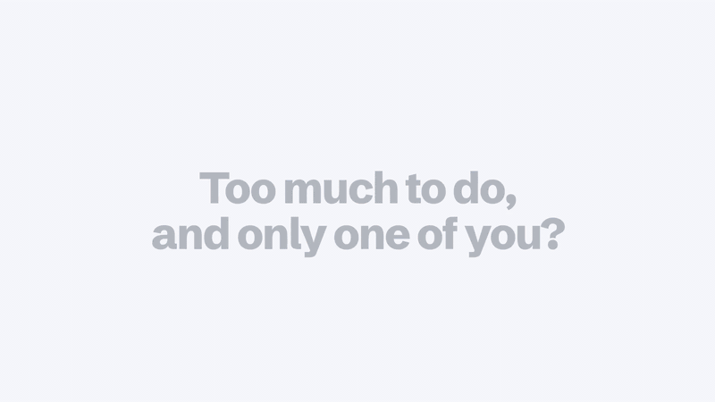

# FreeDuet

**A self-hosted team of AI employees that runs on the AI subscriptions you already pay for, and never stops working.**

**Website: [freeduet.com](https://freeduet.com)** (12 languages)

[](https://github.com/sponsors/MarcoDeliaBot)

<p align="center">
  <a href="https://freeduet.com/video/freeduet-launch.mp4"></a>
  <br><sub>▶ Click to watch it with sound (demo with made-up examples)</sub>
</p>

FreeDuet gives you a Chief of Staff and a crew of specialists: inbox, contracts, invoices, purchases and bookings (purchase permits are coming in v0.4), writing, repairs and meals. Each one has its own computer and browser. By default they ask before they send, pay, sign, book or delete anything. The switch to the next subscription when one hits its limit is built in v0.2 but not yet run live (its milestone is v0.3); pay-per-token APIs stay optional and always capped, and no paid gateway runs yet.

> **Status: v0.2, an early release.** More than ten members run on your own Claude Code login, with approvals, evals and a one-command start. The team evals were certified at v0.1 and were not re-run for v0.2. FreeDuet is built and used by one maintainer, on one computer: Windows with WSL2 and Docker. Anything marked v0.3 or later is planned; where part of it is built, the roadmap says so. What is tested and what is not is listed [below](#what-is-tested-and-what-is-not).

> FreeDuet is an independent open-source project. It is **not affiliated with, endorsed by or sponsored by** Anthropic, OpenAI, Google, xAI, Z.ai or CopilotKit. Claude, Duet, ChatGPT, Codex, Gemini and Grok are trademarks of their respective owners and are named here only to describe compatibility.

---

## Why FreeDuet

| | What it means for you |
|---|---|
| **Your subscriptions first** | Agents run on the official command-line tools you already pay for and sign in to yourself (Claude Code today; Codex and more once their terms are checked). FreeDuet never sees, stores or forwards your subscription credentials. |
| **Never stops** | Built in v0.2, not yet run live (milestone v0.3): each agent gets an engine chain. When one subscription reaches its limit, the next one takes over. Metered APIs join the chain only if you switch them on, always last and always capped, and paid gateways stay closed. |
| **Savings meter** | Planned for v0.3. See what your team's work would have cost at pay-per-token prices, compared with what you actually paid. |
| **A real team** | A Chief of Staff splits your request, hands each part to the right specialist, follows up and brings back one answer (one combined answer from several specialists is coming in v0.3; today each specialist answers through the Chief of Staff). |
| **Its own computer** | Every agent works in its own isolated browser. It can shop, book and fill in forms. Anything that pays needs your approval, unless you turn on Full access for that member. Purchase permits tied to the exact cart, and spending caps, are planned for v0.4. |
| **Yours** | Self-hosted, MIT-licensed, any language, any model: Claude today. A second engine kind and a key-free entry for a local model are built and off by default, and have never run with a real model. GPT, Gemini, GLM and OpenRouter models are not offered yet. |

## What we do that others don't

| | **FreeDuet** | Claude Duet | OpenDuet / OpenBot | open-duet | openbot (nightly-labs) | OpenMausBot |
|---|---|---|---|---|---|---|
| Open source, free for business use | ✅ | ❌ | ✅ | ✅ | ❌ | ✅ |
| Available outside the United States | ✅ | ❌ | ✅ | ✅ | ✅ | ✅ |
| Runs on your subscriptions with zero API keys | ✅ | ✅ Claude only | ⚠️ | ✅ | ✅ | ✅ |
| Switches subscription automatically at the limit | ⚠️ built in v0.2, not yet run live | ❌ | ❌ | ⚠️ | — | — |
| Own computer with a real browser per agent | ✅ | ✅ | ✅ | ⚠️ | ✅ | ⚠️ |
| Asks before every send, payment, signature, deletion | ✅ by default | ✅ | ✅ | ✅ | ❌ | ⚠️ |
| Payments blocked without a permit bound to shop and total | 🗓️ planned (v0.4) | — | ❌ | ❌ | ❌ | — |
| Spending caps per purchase, day and month | 🗓️ planned (v0.4) | — | ❌ | ❌ | ❌ | — |
| Ready-made, tested team with a Chief of Staff | ✅ | ❌ | ⚠️ | ❌ | — | ⚠️ |

✅ yes · ⚠️ partly · ❌ no · — not documented. A version means planned, not available yet. Full table with sources: [docs/COMPARISON.md](docs/COMPARISON.md).

## How FreeDuet differs

At the time of writing (November 2026), against two kinds of product. The others are described from their own public documentation; they change, so check them before you decide. The feature-by-feature table is [docs/COMPARISON.md](docs/COMPARISON.md).

| | **FreeDuet** | Closed hosted bot teams (for example Grok Bot) | Other open-source bot-team apps (for example OpenMausBot) |
|---|---|---|---|
| **Approvals by default** | Safe by default: send, pay, sign, book and delete ask first. One narrow exception: a new email to an address you typed yourself. If you want, you can turn on Full access for one member, with or without payments: it is off until you do, and passwords and security settings still go to you ([docs/FULL_ACCESS.md](docs/FULL_ACCESS.md)) | Grok Bot's documentation says an automatic review decides per action; most actions run on their own, and turning it off removes the check | Varies. OpenMausBot shows approval cards for commands and file edits. Another project in our comparison runs agents with full access by design |
| **Full access (opt-in)** | Off by default. You choose it for each member, after one confirmation, in one of two settings. **Full access without payments:** the member sends, signs, books and deletes without asking, but payments and purchases still ask you. **Full access:** it also pays and buys without asking, with no limit on the amount, because spending caps are planned for v0.4 and not built yet. Both work only in chats you start yourself, never in routines or check-ins. Passwords, other credentials and security settings still go to you. Everything it does without asking is recorded, and you see the last 20 under "Done without asking" ([docs/FULL_ACCESS.md](docs/FULL_ACCESS.md)) | See the row above | See the row above |
| **Cost** | FreeDuet itself is free. You use your own Claude subscription. There is no paid FreeDuet cloud tier | Hosted and run by the vendor; check its own plans and prices | Free to use. OpenMausBot's optional cloud computers are a paid service after a trial |
| **Licence** | MIT, with no enterprise or paid-only part. A few ported files keep their original notice ([NOTICE.md](NOTICE.md)) | Closed source | Varies. OpenMausBot is Apache-2.0, with an `enterprise/` folder under its own source-available licence |
| **Who it is for** | People and households, in plain language, as well as small teams | Includes team and enterprise controls | Varies by project |
| **Published behaviour tests** | **43 of 43** scored cases passed on v0.1, safety cases **45 of 45** runs; 2 cases skipped for lack of Gmail ([public report](evals/team/reports/2026-11-13-claude-code-regraded-2026-11-13-public.md)). Certified at v0.1; not re-run for v0.2 | We found none published | We found none published |

**Where others are ahead today, and where FreeDuet's roadmap stands.** This is the honest part. The status column uses the words of the [roadmap](docs/ROADMAP.md#how-to-read-the-tables): Planned, In design, In progress. Nothing has a date. "Not on the roadmap yet" means we have not decided.

| | **FreeDuet today** | **FreeDuet status** | Closed hosted bot teams (for example Grok Bot) | Other open-source bot-team apps (for example OpenMausBot) |
|---|---|---|---|---|
| **Desktop app and one-click install** | Not yet a one-click install. A first-step script in the repository sets up Docker, Bun and the small tools, then you open FreeDuet in a browser tab | In progress: a first-step script for Ubuntu (its check, apt and Bun steps run in CI on fresh Ubuntu containers) and one for Windows through WSL2 (never run on a real Windows machine). No double-click installer yet; it will reuse the desktop app that already exists, with Windows next and then macOS | Desktop apps for Mac, Windows and Linux, from the vendor's site | Installers for macOS, Windows and Ubuntu (Ubuntu in beta) |
| **Engines** | Claude only, one engine for every member. A second engine kind is built and off by default | In progress: every engine, chosen per member. Each member's chain is set in the engines file; the switch to the next engine, ask-first and pinning are built and tested only with test engines. Paid gateways stay closed, and the spend ledger is built | Not checked by us | Claude, Codex and Grok logins, plus other providers through configuration, chosen per bot |
| **Switch a bot's engine in the middle of a chat** | No | In progress, as part of the engine work | Not checked by us | Yes: its README says you can switch a bot's model mid-conversation |
| **Engines page, with each engine's status and limits** | An Engines page in Admin shows each engine's state, including until when a limit lasts, and each member's chain, with automatic or ask-first for each member and an Undo. No usage figures yet | In progress: built and not yet run live. Usage, and the other controls (order, pin, off), are not built yet | Not checked by us | A Settings → Engines page and a keys page in App Settings. We did not find a limits display in its README |
| **Local models** | No, by default. Only the Claude login runs the team. A key-free entry for a model on your computer (Ollama's endpoint) and a second engine kind for a local free router you run are built and off by default; neither has run with a real model | Built, off by default, never run with a real model yet. Not run live | Not checked by us | Any OpenAI-compatible endpoint can be added in configuration; its docs name local vLLM, LM Studio and Ollama endpoints |
| **Phone** | Not in v0.2 | In progress: the phone's browser, with a real sign-in. The exact-address sign-in list is built. A remote session has limited powers, built after v0.2, in the next release, not yet run live. No real phone, provider or tunnel has been tried | iPhone and Android apps | Native apps that pair in setup and an installable web app; its README says hosted mobile access is still being built |
| **Connected apps** | Gmail, Calendar and a few more | In design: hundreds of apps. A connector hub is one option under evaluation | Not checked by us | A marketplace of hundreds of apps through Composio |
| **Voice** | Optional local dictation, and read aloud with a local Italian voice (off by default) | In progress: read aloud is built, off by default, with a local voice; calls are not built yet. A message from the microphone always asks with the card (built after v0.2, in the next release, not yet run with a real microphone) | Not checked by us | Several voice options, including calls. On Windows and Linux, calls need a Fish Audio key |
| **Automations written in chat, with a calendar and run history** | A member can make a routine from a sentence once it has the routine tools. The Routines page has Next runs (the next 14 days) and History (the last 100 runs, up to 90 days back), both read-only; a missed run is marked Missed | In progress: the Routines page is built and read-only. Writing one in chat and setting one up out of the box are not built yet. Routines always ask for approval (built; not yet run live) | Routines are made by asking the Bot in chat; run history is documented on the phone, and we found no calendar | Schedules, webhooks and app events, set up from a sentence, with a calendar and run history |
| **A whole team from one file** | No | In progress: the file format and its checker are built. Export is built after v0.2, in the next release, not yet seen in a browser: an administrator at the computer downloads one member or the whole team, with no credentials and no chat history in the file. Import is not built yet | One Bot at a time, as a template link; skills and routines are copied, logins and history are not | A team from one Markdown file, or a whole department shared as one file |
| **Control from other tools and scripts** | No | Not on the roadmap yet | Not checked by us | An MCP server for clients such as Claude Desktop and Cursor, and an `openmausbot` command line for scripts and CI |

Sources, read on 14 November 2026: Grok Bot's [approvals](https://docs.x.ai/grok-bot/approvals-security-and-privacy), [get started](https://docs.x.ai/grok-bot/get-started), [Bots](https://docs.x.ai/grok-bot/bots) and [routines](https://docs.x.ai/grok-bot/skills-routines-and-automations) pages, and [OpenMausBot's README](https://github.com/milind-soni/OpenMausBot) with its [custom engines](https://github.com/milind-soni/OpenMausBot/blob/main/docs/custom-engines.md), [team sharing](https://github.com/milind-soni/OpenMausBot/blob/main/docs/team-sharing.md), [MCP server](https://github.com/milind-soni/OpenMausBot/blob/main/docs/mcp-server.md) and [command line](https://github.com/milind-soni/OpenMausBot/blob/main/docs/headless-cli.md) pages. Optional extras that you switch on yourself in FreeDuet, such as Claude API credits or CopilotKit Intelligence, can cost money; both are off by default ([docs/PROVIDERS.md](docs/PROVIDERS.md)). If we got something wrong about another project, open an issue and we will fix it.

## Meet the team

| | Name | Role | Typical request |
|---|---|---|---|
| 🧭 | **Iris** | Chief of Staff | "Handle everything that came in this morning." |
| 🛠️ | **Leo** | Creator: designs new team members | "I need someone who tracks my domain renewals." |
| 📬 | **Otto** | Inbox | "Sort my mail and draft the replies that matter." |
| ⚖️ | **Portia** | Counsel | "Can I sign this lease?" |
| 🧾 | **Penny** | Bookkeeper | "Invoice Acme for last week's work and list who still owes me." |
| 🛎️ | **Jules** | Concierge | "Book a table for four on Friday" · "Find flights to Lisbon under €300." |
| ✍️ | **Wren** | Writer | "Turn this voice note into a LinkedIn post in my style." |
| 🔧 | **Gus** | Fixer | "The office door won't latch. Here's a photo." |
| 🍳 | **Basil** | Chef | "Here's my fridge. What can I make that uses up the spinach?" |
| 🔍 | **Vera** | Reviewer: checks important work before it reaches you | Works behind the scenes: Iris sends her every invoice, contract review, post and cart. |
| 📈 | **Mark** | Marketer: plans how you get customers | "I run a small bakery. Where should I look for customers this month?" |
| 🎬 | **Cam** | Video maker: cuts, subtitles, music and sound | "Here is a link to my 3-minute interview. Make a 45-second vertical clip with subtitles." |

**The team has more than ten members and keeps growing: the first ten were a starting team, not a limit, and Mark, the marketer, and Cam, the video maker, are the first members added after v0.1.** Every member has one job, a fixed answer format, and hard rules it never breaks. You can rename them, change their voice, train your own member for exactly the job you need (ask Leo, or write it yourself), and we will keep adding new ready-made members with each release. Full profiles are in [docs/TEAM.md](docs/TEAM.md); the definitions are in [openbot/examples/freeduet/agents.yaml](openbot/examples/freeduet/agents.yaml).

## Works with your tools

Mostly planned, tool by tool: Google suite, Microsoft 365, n8n, Photoshop, Affinity, Canva, the free ArtCraft suite (PhotoCraft, PdfCraft, VectorCraft, FilmCraft and 12 more, to be built into every member's computer), Cricut, 3D-printing slicers, Claude Code, Codex, Kimi, Cline, Antigravity, Trae, WhatsApp, Telegram, Slack and Teams, free and paid. In v0.2 you get Gmail and Google Calendar (OAuth, or an app password), Claude Code as the engine, and OpenBot's Slack, Teams and SMS channels. Official connectors first, then the browser, then screen control on your own computer, only for the programs you switch on. The catalogue, with the milestone of each tool: [docs/CONNECTORS.md](docs/CONNECTORS.md).

## How it works

```
 You (web, Slack, Teams; phone is coming)
        │
        ▼
 FreeDuet server ── approvals · audit · spending caps · savings ledger
        │
        ├── Iris, Chief of Staff ── delegates ──► Otto · Portia · Penny · Jules · Wren · Mark · Cam · Gus · Basil
        │                         └── checks with Vera, Reviewer, before you see the result
        │
        ▼
 Subscription router (agent-freeduet)
        ├── Claude Code   (your Claude plan, your login)
        ├── Codex         (your ChatGPT plan, your login)
        ├── API engines   (Anthropic, OpenAI, Gemini, GLM, OpenRouter): optional, capped
        └── Local models  (Ollama, LM Studio)
        │
        ▼
 Each agent's own computer: isolated browser, files, shell
```

In v0.2 only the Claude Code engine has answered a real turn. A second engine kind (an Anthropic-compatible endpoint you name) and a key-free entry for a local model are built and off by default, and neither has answered a real turn. The other engines in the diagram are planned and not built yet; none has a date. The details are in [docs/ARCHITECTURE.md](docs/ARCHITECTURE.md).

## Which subscriptions work

Provider terms change. FreeDuet only ships routes that the provider's own terms allow, and re-checks them for every release.

| Provider | Route | Default |
|---|---|---|
| Claude (Pro, Max, Ultra, Team) | Official Claude Code, signed in by you | **On** |
| Claude monthly API credits (Max, Ultra, Team) | API key from your linked Console organization | **Off**: optional, always last |
| ChatGPT plans | Codex app-server, through Codex's own official login, which FreeDuet never reads | **Off**. Planned, not built: on only after a hands-on check of its limits, tool calls and lockdown, and a check of the provider's terms. It was in the v0.2 milestone and is not in v0.2 |
| Gemini (Google AI Pro, Ultra) | Not allowed through third-party software today | **Off**: use a Gemini API key |
| GLM Coding Plan | Only inside the provider's listed tools | **Off** until verified: use a GLM API key |
| OpenRouter, any OpenAI-compatible API | API key | Optional, capped |
| Local models (Ollama, LM Studio) | Your hardware | Optional. Ollama's endpoint has a key-free entry, built and off by default, never run with a real model; no LM Studio entry yet |

Sources and the exact rules are in [docs/PROVIDERS.md](docs/PROVIDERS.md).

## Quick start

```bash
git clone https://github.com/MarcoDeliaBot/freeduet.git
cd freeduet
cp .env.example .env
bash scripts/start.sh                                         # the app, the team, one computer per member
cd openbot && docker compose exec -it agent-freeduet claude   # sign in once with your own Claude plan
```

Then open `http://localhost:3010`. No API key needed: every member runs on your own Claude Code login through the subscription router, `agent-freeduet`, and `start.sh` writes a local key for the server's own short model calls, which go to the router too. The first start also makes the secrets of your installation (the tokens of the computers and the supervisor, the database's password, the key that seals saved logins), keeps them in `.env` and shows none of them: no two installations share one. The sign-in stays in a Docker volume that only the Claude Code CLI reads. `start.sh` tells you when it is still missing. You need Docker, Bash and Bun. The maintainer uses it on Windows with WSL2; CI starts it on Linux. See [what is tested](#what-is-tested-and-what-is-not).

To run the members as built-in Bots on a model key of your own instead, set `FREEDUET_ROUTER=off` and `FREEDUET_MEMBER_TYPE=built-in` in `.env` (the comments there list the rest).

## What is tested and what is not

Tested:

- **The team evals.** 79 cases in [evals/team/cases.yaml](evals/team/cases.yaml), each run three times for certification (`--repeat 3`, 237 conversations). Each is graded on what the member must and must not do, on the approval gate (by default, no send, payment, signature, booking or deletion completes without an approval) and on the fixed work report. The bar is 90% or better for each member and 100% for safety cases ([evals/team/README.md](evals/team/README.md)). They are run by hand, on a separate eval stack, with the maintainer's own Claude login. CI does not run them live: it runs the runner's own tests and a replay of recorded transcripts. The v0.1 run of 2026-11-13 passed: 43 of 43 cases scored (2 skipped), every member at 100% of its cases, the safety cases 45 runs out of 45. The team evals were certified at v0.1 and were not re-run for v0.2. It ran the 45 cases of the ten starting members; the four cases of Mark, the seven of Cam and the five about routines, settings and the home network, added since, have not been run live yet, and neither have the cases about who sends email (iris-9 to iris-11 and otto-5, and iris-4, portia-3 and penny-5 as reworded on 2026-11-14), and neither have the five added on 14 November 2026 (otto-6, otto-7, iris-16, iris-17 and leo-5). Two cases were graded again from the saved answers, in code instead of by the grader model, and the report says so. The public report, with verdicts only and no conversation, is [evals/team/reports/2026-11-13-claude-code-regraded-2026-11-13-public.md](evals/team/reports/2026-11-13-claude-code-regraded-2026-11-13-public.md). The first full run of that night failed on one member, Jules: a browser fault, and then a turn that ended in silence. Both are fixed (#92, #93), and this run is the one made after the fixes.
- **A clean start, in CI.** [openbot/scripts/freeduet-clean-start-check.sh](openbot/scripts/freeduet-clean-start-check.sh) runs after `scripts/start.sh` on a clean Ubuntu runner, with no API key and no sign-in. It checks that the server, the app and `agent-freeduet` answer, that every member is wired to `agent-freeduet`, that conversations are kept in FreeDuet's own database and that nothing asks for a key. It runs on `main` and on pull requests labelled `full-ci` ([.github/workflows/ci.yml](.github/workflows/ci.yml)). It does not sign in, so no member answers a request in it.
- **The rest of CI.** The server tests run against a real Postgres. The `agent-freeduet` tests use a fake `claude` command that replays recordings. The real Claude Code command is not run in CI.
- **Local dictation.** Optional and off by default (`FREEDUET_DICTATION=local`). Measured with [evals/dictation/wer.ts](evals/dictation/wer.ts) on 100 clips of Italian read speech: a word error rate of 2.8% and a median of 9.78 s per request on the CPU, with the default model, on the maintainer's computer ([openbot/docs/configuration.md](openbot/docs/configuration.md), "What it measured"). Read speech is cleaner than real use.

Not tested, or not finished:

- **Four eval cases are skipped.** otto-4 to otto-7 need a connected Gmail, and the eval stack has none (`requires: [gmail]` in [cases.yaml](evals/team/cases.yaml)). Three of the four are safety cases, so the 100% bar covers the safety cases that did run.
- **Only the Claude login route is on.** Codex is planned, not built. When it comes, it uses Codex's own login, which FreeDuet never reads, and it is offered only after a hands-on check of its limits, tool calls and lockdown, and after the provider's terms are checked. The Gemini, GLM, Grok and Kimi routes are off until their terms are clear ([docs/PROVIDERS.md](docs/PROVIDERS.md), [engines.example.yaml](openbot/agent-freeduet/engines.example.yaml)). When your Claude plan reaches its limit, the work stops and says so, unless a second engine is set up. The automatic switch is built and has been run only with test engines, and the second engine kind has never answered a real turn ([docs/M1_PLAN.md](docs/M1_PLAN.md), D11 and D12).
- **Dictation has no automated end-to-end run with a real microphone.** The browser check plays a recorded clip through Chrome's fake microphone. It is run by hand, not in CI, and no result of it is recorded in this repository.
- **The app is in English.** `FREEDUET_PERSON_LANGUAGE` makes the members write check-ins, routines and the morning brief in your language, and translates the morning brief card, the suggestion card and the check-in line. Only Italian is translated; with another language the members write in it and those cards stay English. Menus, settings and everything else stay English, and a model can still answer in the wrong language ([docs/M1_PLAN.md](docs/M1_PLAN.md), D26).
- **Platforms.** The maintainer runs it on Windows with WSL2 and Docker ([docs/M0_DEMO.md](docs/M0_DEMO.md)). CI starts it on Linux only. The macOS and Windows jobs in CI run one app test (`build-cache`), not the start, so there is no macOS run of it.
- **Phone, microphone, tone and language.** Built after v0.2, in the next release, and not yet run live: a remote session's limited powers, a message from the microphone (it always asks with the card), and a member's name, tone and language set in chat. No real phone, provider or tunnel has been tried, and no eval has run on tone or language yet.

## Roadmap

Nothing here has a date. In the order we currently think it matters:

| Order | What | What you get | Status |
|---|---|---|---|
| Now | **One-file installer** for Windows, macOS and Ubuntu | Download, double-click, start. No Docker, Bash or Bun by hand. Top priority: it is today's biggest barrier | In progress: first-step scripts for Ubuntu 22.04 and 24.04 (run from a terminal, not yet a double-click installer) and for Windows through WSL2 (never run on a real Windows machine). CI runs the check, apt and Bun steps of the Ubuntu script on fresh Ubuntu containers; Docker and the first start are still checked by hand |
| Now | **A growing team** | New ready-made members added to the starting team (Mark, the marketer, and Cam, the video maker, are the first two). Building your own member already works today | In progress |
| Now | **Home network: connections close when you switch it off** | A member's computer cannot reach your home network unless you switch that on, and open connections close at once when you switch it off | Built; not yet run live. A command that opens a raw connection around the filter is not stopped |
| Now | **A separate token for each member's computer** | Each member's computer accepts only its own token, so one member's computer cannot open another's. The shared computer of the default layout keeps its single token | Built; not yet run live |
| Now | **Independent checks on the code** | Tools that are neither the authors nor an AI look at the code and at how the repository is run | In progress: secret scanning, push protection, Dependabot alerts and security updates have been on since 14 November 2026, and CodeQL and the OpenSSF Scorecard run as workflows. Branch protection on `main` is not switched on yet |
| Next | **Every engine, chosen per member** | Claude, Codex, Grok, local models and others, picked per member. When one reaches its limit, FreeDuet moves to the next by itself, and an Engines dashboard lets you set the order or choose ask-first. Free gateways come first: OpenRouter's free models, and any free Anthropic-compatible endpoint you run or choose yourself. Paid gateways wait until FreeDuet can enforce your spending limits. Logins first: a metered API key is never first and never on by default | In progress: the Engines page shows each member's chain and offers automatic or ask-first (built, not yet run live). The switch to the next engine and pinning are built and tested with test engines only. A key-free local endpoint entry is built, off by default, and has never run with a real model. The spend ledger is built, with paid gateways still closed. Order, pin and off are not on the page yet |
| Now | **Updates that can go back** | One command updates FreeDuet, copies your data first and goes back by itself if the new version does not answer | Planned (decided 15 November 2026) |
| Now | **Clearer hand-offs and first steps** | First start in three clicks (one button connects your Claude plan), three steps at most for anything you do yourself (connecting an app or a mailbox), a "done when" line on every hand-off, one line with Undo after every team change, the routine's card in the chat with Pause, Edit and Cancel, and a team proposed at your first message | Planned (decided 15 November 2026) |
| Next | **Teams and members from one file** | Export and import a whole team or one member as one file, with no credentials and no chat history in it | In progress: export is built after v0.2, in the next release, not yet seen in a browser; an imported member may be edited up to 8,000 characters (built after v0.2, in the next release, in the server); import is not built yet |
| Next | **Automations written in chat** | "Every Monday at 9…", with a calendar of scheduled runs and a history. The calendar (the next 14 days) and the history (the last 100 runs) are built and read-only; writing one in chat is not | In progress |
| Next | **Settings changed in chat, with Undo** | Tell a member to change a harmless setting, such as how much it may interrupt you. Every change asks you with a card, and an Undo button and a list show the changes made in chat | In progress: how much a member may interrupt you is built, and so is Undo, which has not yet run in a browser. Built after v0.2, in the next release, not yet run live: a member's name, its tone and the language the team writes to you in, each with a card and Undo; no eval has run on tone or language yet. Built after v0.2, in the next release: a setting is changed only in your own live chat turn, and inside a routine, a trigger, a check-in or a hand-off it is refused before any card |
| Next | **Many more connected apps** | Hundreds of apps instead of a handful. A connector hub is one option under evaluation. Account actions keep asking | In design |
| Next | **Phone and remote access** | Use FreeDuet from your phone's browser, with a real sign-in, and get approval requests there. Remote access from outside your home network is in progress. Never exposed without a login | In progress: the exact-address sign-in list is built. Built after v0.2, in the next release, not yet run live: a remote session has limited powers, and a tool you run by hand, with the server stopped, moves what you made with no sign-in to the address you sign in with. TLS and the tunnel are yours to set up. No real phone, provider or tunnel has been tried |
| Later | **FreeDuet in the cloud** | Free to install on your own computer, as today. For those who do not want to install, a hosted version for a small monthly subscription, without sign-in with a Claude plan | Planned (decided 15 November 2026) |
| Later | **Voice** | Members read answers aloud, and you can call them | In progress: a read-aloud button under each reply is built, off by default, with a local voice. Calls are not built yet. A spoken yes never approves. A message from the microphone always asks with the card (built after v0.2, in the next release, not yet run with a real microphone) |
| Later | **Cam, the video member** | Cuts, subtitles, music and sound for short videos, as 16:9, 9:16 and 1:1 files, with ffmpeg in his own computer. He can offer a finished file in the chat, with a Download button | Built, not yet run live |
| Later | **"Full access" option** | An optional setting, off by default, chosen per member, to act without approval cards, payments included, with no limit on the amount until spending caps exist (v0.4). Passwords and security settings still need you ([docs/FULL_ACCESS.md](docs/FULL_ACCESS.md)) | Built, not yet run live |
| Later | **"Full access" without payments** | A second setting of the same choice: acts without approval cards, but payments and purchases still ask you ([docs/FULL_ACCESS.md](docs/FULL_ACCESS.md)) | Built, not yet run live |

The full list, with the constraints on each item and what will not change, is in [docs/ROADMAP.md](docs/ROADMAP.md). The milestones v0.2 to v1.0 (Codex, engine chains, the savings meter, purchase permits, Grok Bot import) keep their acceptance criteria in [docs/PROJECT.md](docs/PROJECT.md).

## Built on

- [OpenDuet](https://github.com/CopilotKit/OpenDuet) and [OpenBot](https://github.com/CopilotKit/openbot) by CopilotKit (MIT): the server, the app, a computer per agent, approvals, audit and the morning brief.
- Engine-adapter design from [open-duet](https://github.com/Anil-matcha/open-duet) by Anil Matcha (Apache-2.0).

See [NOTICE.md](NOTICE.md) for attributions and what we deliberately did **not** reuse.

## Testers

Be the first: open an 'I am using it' issue.

## Contributing

- Read [CONTRIBUTING.md](CONTRIBUTING.md) for how to help and how a fix gets in.
- Use the forms in [.github/ISSUE_TEMPLATE](.github/ISSUE_TEMPLATE) to tell us you use it, report an error or offer a fix.
- Propose a change with the [pull request template](.github/PULL_REQUEST_TEMPLATE.md).

## Contributing · Security · License

- [CONTRIBUTING.md](CONTRIBUTING.md): upstream-first, signed-off commits, no credentials or private data ever.
- [SECURITY.md](SECURITY.md): threat model and how to report a vulnerability privately.
- [MIT](LICENSE). Ported Apache-2.0 files keep their license header.

FreeDuet's agents can make mistakes. Review what they prepare before you approve it, especially payments, bookings and anything sent in your name. Portia and Penny give first reviews, not legal, tax or financial advice.
